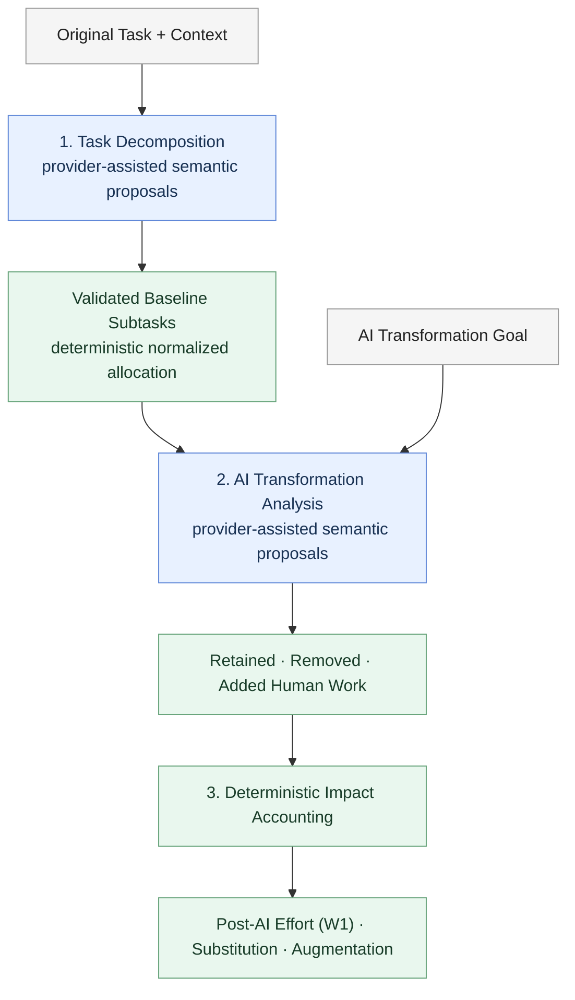

# Task Transmorph

Task Transmorph is a host-neutral Python library for answering two related questions:

1. What operational work makes up a task, and how is its baseline effort distributed?
2. What happens to that work when an AI-assisted transformation is introduced?

It uses providers for semantic proposals—subtasks, effort rationales, RETAIN/REMOVE classifications, and human interaction or verification activities—and uses deterministic application code for allocation and accounting. The main result is a validated `TransformationDecompositionResult` containing the transformation facts, assumptions, provenance, and canonical W0/W1 impact metrics.

Task Transmorph is output-unit anchored. It models expected active human effort per completed parent output—such as one invoice, claim, ticket, or schedule. For each subtask, expected effort is `expected_occurrences_per_parent_output × active_effort_per_occurrence`. W0 and W1 are baseline and post-AI human effort on that same parent-output basis. This is distinct from resource capacity, staffing, and workflow throughput; those are downstream concerns.

> [!NOTE]
> **Built-in LLM providers:** **OpenAI, DeepSeek, and Google Gemini.** These are the three bundled integrations; custom providers can implement the public provider interfaces. Deterministic accounting works without an LLM.

The primary estimation workflow is:

```text
decompose_task() → TaskDecomposition → estimate_transformation() → TransformationDecompositionResult
```

Normalized estimates are comparative planning signals. They are not measured hours, capacity, or validated productivity improvements.

## How It Works

### High Level



Blue stages use an LLM provider to propose semantic facts, including effort estimates; green stages represent Python validation, normalization/allocation, or accounting. The estimates themselves are not deterministic merely because they are provider output. Gross removed work is counted against the baseline, **not** added to post-AI effort. Only retained work plus added interaction/verification work contributes to W1. The transformation consumes the frozen baseline; it does not regenerate the task decomposition.

### Illustrative supplier-invoice numbers

For one completed invoice review, an illustrative output-anchored calculation is `W0 = 14 min/invoice`, `W1 = 10 min/invoice`, net substitution `= 28.6%`, and augmentation multiplier `= 1.40×`. These are illustrative values, not actual API results. See the [Supplier Invoice Transformation Example](examples/supplier_invoice_transformation.md) for the detailed allocation, classifications, and calculations.

## Provider-Assisted Quick Start (Normalized Estimation)

Install the OpenAI integration (`python -m pip install "task-transmorph[openai]"`) and set `OPENAI_API_KEY` before running this example. It makes live LLM calls. Replace `"openai"` with `"deepseek"` or `"gemini"` after installing the corresponding extra and configuring its API key.

```python
from task_transmorph import (
    TaskDecompositionRequest,
    TaskReference,
    decompose_task,
    estimate_transformation,
)

request = TaskDecompositionRequest(
    task=TaskReference(
        task_name="Review a supplier invoice",
        task_description="Validate invoice details, resolve exceptions, and approve or reject the invoice.",
    ),
    task_context={"domain": "accounts_payable"},
)

# Provider-assisted baseline: operational subtasks and normalized weights.
baseline = decompose_task(request, provider="openai")

# Provider-assisted transformation: no host-supplied ratios are required.
result = estimate_transformation(
    baseline,
    provider="openai",
    transformation_context={
        "goal": "Use AI to draft invoice checks while retaining human approval",
    },
)

accounting = result.accounting
print("normalized baseline W0:", accounting.w0)
print("post-transformation human effort W1:", accounting.w1)
print("gross removed work ratio:", accounting.gross_removed_work_ratio)
print("added human work ratio:", accounting.added_human_work_ratio)
print("net substitution ratio:", accounting.net_substitution_ratio)
print("augmentation multiplier:", accounting.net_augmentation_multiplier)

for item in result.retain_remove_classification.classified_subtasks:
    print(item.subtask_id, item.classification, item.rationale)

print("assumptions:", result.estimation_assumptions)
for estimate in result.normalized_work_estimates:
    print(estimate.subtask_name, estimate.assumption, estimate.rationale)

if result.human_agent_activity_modeling:
    for activity in result.human_agent_activity_modeling.activities:
        print(activity.category, activity.activity_name)

if result.activity_effort_estimation:
    for estimate in result.activity_effort_estimation.activity_effort_estimates:
        print(estimate.activity_id, estimate.rationale, estimate.assumptions)
```

In normalized mode, `accounting.w0` is exactly `1` and `accounting.w1` is the comparable post-transformation effort. Use the normalized ratio fields rather than interpreting W0/W1 as hours or capacity. Absolute quantity fields such as `accounting.baseline_human_effort`, `accounting.net_human_effort`, and `accounting.added_human_work` are `None` in this mode. Automatic provider-assisted estimation of missing absolute effort quantities is a future enhancement, not current behavior.

## Installation

Task Transmorph supports Python 3.10 and newer.

```bash
python -m pip install task-transmorph
# or in a uv project:
uv add task-transmorph
```

Provider SDKs are optional. Install the extra for the provider you intend to use (or `providers` for all three):

```bash
python -m pip install 'task-transmorph[openai]'
python -m pip install 'task-transmorph[gemini]'
python -m pip install 'task-transmorph[deepseek]'
python -m pip install 'task-transmorph[providers]'
```

For development from a checkout:

```bash
python -m pip install -e .
uv build
# or:
python -m build
```

The deterministic contracts, allocation utility, and accounting functions do not require a provider SDK or an LLM call.

## API Overview

The four public application entry points map to the canonical flow:

- `decompose_task(request, provider, *, evaluator=None, model=None, max_output_tokens=None)` creates a reusable `TaskDecomposition`. It validates provider-generated operational subtasks and complete bottom-up effort estimates, derives relative allocation weights from expected effort per parent output, and normalizes those weights to `W0 = 1.0` (or materializes compatible absolute allocations when a baseline effort is supplied).
- `estimate_transformation(task_decomposition, provider, *, evaluator=None, transformation_context=None, model=None, max_output_tokens=None, request_id=None)` is the provider-assisted estimation workflow. It consumes the existing baseline, derives normalized RETAIN/REMOVE work from provider classifications, estimates added human support work, and returns deterministic comparative accounting with `W0 = 1.0`; it does not produce host-calibrated absolute effort quantities.
- `decompose_transformation(request, provider, *, evaluator=None, model=None, max_output_tokens=None)` is the strict transformation operation. Its `TransformationDecompositionRequest` must contain an existing baseline and explicit `AbsoluteEffortInput` or `NormalizedAccountingInput`; it never regenerates the baseline.
- `decompose(request, provider, *, transformation_context, accounting_input, model=None, max_output_tokens=None)` is convenience composition: it runs `decompose_task()` and then `decompose_transformation()` in one call. It is useful when the host already owns accounting inputs, but it is not the default estimation workflow.

`provider` can be a constructed provider object or the built-in name `"openai"`, `"gemini"`, or `"deepseek"`. A named provider can receive a per-call `model` and `max_output_tokens` override. Import protocols from `task_transmorph.interfaces` when implementing a custom provider.

## API Data Structures

The public contracts are Pydantic models. The following shapes show the fields most applications use; they are abbreviated views, not complete schemas.

### Provider-assisted estimation

```text
TaskDecompositionRequest
├── task: TaskReference
│   ├── task_name: str
│   └── task_description: str | None
├── task_context: dict[str, str]
├── parent_output_contract: ParentOutputContract | None
└── baseline_effort: EffortQuantity | None

decompose_task(...)
└── TaskDecomposition
    ├── operational_decomposition
    │   └── operational_subtasks[]
    │       ├── subtask_id
    │       ├── subtask_name
    │       ├── relative_effort_weight
    │       └── effort_rationale
    └── baseline_effort_allocations[]

estimate_transformation(...)
├── task_decomposition: TaskDecomposition
└── transformation_context: dict[str, str]

TransformationDecompositionResult
├── retain_remove_classification
│   └── classified_subtasks[]
├── agentic_task_synthesis: AgenticTaskSynthesis | None
├── human_agent_activity_modeling: HumanAgentActivityModel | None
├── activity_effort_estimation: ActivityEffortEstimation | None
├── normalized_work_estimates[]
├── estimation_assumptions[]
└── accounting: CanonicalTransformationImpact
```

The baseline is reusable: transformation estimation consumes the existing `TaskDecomposition` and does not regenerate its subtasks or effort allocation.

### Host-supplied accounting

`decompose_transformation()` receives a `TransformationDecompositionRequest` with an existing baseline, transformation context, and one explicit accounting input:

```text
TransformationDecompositionRequest
├── task_decomposition: TaskDecomposition
├── transformation_context: dict[str, str]
└── accounting_input
    ├── AbsoluteEffortInput
    │   ├── baseline_human_effort: EffortQuantity
    │   ├── retained_human_work: EffortQuantity
    │   ├── gross_removed_work: EffortQuantity
    │   └── support_work: SupportWorkInputs | None
    └── NormalizedAccountingInput
        ├── retained_work_ratio: Decimal
        ├── gross_removed_work_ratio: Decimal
        └── support_work: SupportWorkInputs | None
```

These are partial constructor shapes for orientation:

```python
TaskDecompositionRequest(
    task=TaskReference(
        task_name="Review a supplier invoice",
        task_description="Validate and approve an invoice.",
    ),
    task_context={"domain": "accounts_payable"},
)
```

```python
AbsoluteEffortInput(
    baseline_human_effort=EffortQuantity(
        value=14,
        unit=EffortUnit.MINUTES,
        time_basis=TimeBasis.PER_OPERATION,
    ),
    retained_human_work=EffortQuantity(
        value=7,
        unit=EffortUnit.MINUTES,
        time_basis=TimeBasis.PER_OPERATION,
    ),
    gross_removed_work=EffortQuantity(
        value=7,
        unit=EffortUnit.MINUTES,
        time_basis=TimeBasis.PER_OPERATION,
    ),
)
```

Common result access looks like this:

```python
result.accounting.w0
result.accounting.w1
result.accounting.net_substitution_ratio
result.accounting.net_augmentation_multiplier

result.retain_remove_classification.classified_subtasks
result.human_agent_activity_modeling.activities
result.estimation_assumptions
```

In normalized estimation, `w0` is `1.0` and the accounting ratio fields are the meaningful comparative outputs. In absolute accounting, the corresponding `EffortQuantity` fields—such as `baseline_human_effort`, `net_human_effort`, and `added_human_work`—are populated when the accounting input and resolved support work use compatible units and time bases.

## Two Usage Modes

### Current provider-assisted estimation

Use `decompose_task()` followed by `estimate_transformation()` when the host has a reusable task baseline but does not have host-supplied accounting inputs. The provider proposes semantic classifications and support-work estimates. The application maps the completed baseline's canonical relative weights onto a 100-unit comparison baseline, normalizes accounting to `W0 = 1.0`, and computes W1 and all ratios deterministically.

This mode is intentionally comparative. A 100-unit baseline is not hours, throughput, staffing demand, or proof of an improvement. Bottom-up expected effort is the allocation source; provider-supplied `relative_effort_weight` values are non-authoritative and do not override the deterministic allocation derived from those products.

### Host-supplied accounting

Use `decompose_transformation()` when the host supplies the accounting basis. The quantities need not be measured observations; they may be planning estimates, provided they are explicit, compatible, and internally reconciled. The request can carry `AbsoluteEffortInput` with explicit units and time basis:

```python
from task_transmorph import (
    AbsoluteEffortInput,
    EffortQuantity,
    EffortUnit,
    TimeBasis,
    TransformationDecompositionRequest,
    decompose_transformation,
)

accounting_input = AbsoluteEffortInput(
    baseline_human_effort=EffortQuantity(
        value=14, unit=EffortUnit.MINUTES, time_basis=TimeBasis.PER_OPERATION
    ),
    retained_human_work=EffortQuantity(
        value=7, unit=EffortUnit.MINUTES, time_basis=TimeBasis.PER_OPERATION
    ),
    gross_removed_work=EffortQuantity(
        value=7, unit=EffortUnit.MINUTES, time_basis=TimeBasis.PER_OPERATION
    ),
)

request = TransformationDecompositionRequest(
    task_decomposition=baseline,
    transformation_context={"goal": "Draft invoice checks while retaining approval"},
    accounting_input=accounting_input,
)
absolute_result = decompose_transformation(request, provider="openai")
print(absolute_result.accounting.baseline_human_effort)
print(absolute_result.accounting.net_human_effort)
print(absolute_result.accounting.added_human_work)
```

`NormalizedAccountingInput` is the strict alternative when the host supplies baseline-relative retained and gross-removed ratios. In the absolute example above, the accounting basis is `14 min/invoice` baseline effort, `7 min/invoice` retained work, and `7 min/invoice` gross removed work. When `support_work` is omitted, the application resolves added support work from validated activity estimates; supplying `support_work` makes the host's values authoritative. This does not estimate missing baseline effort. Providers do not supply canonical W0, W1, substitution, augmentation, or effect values.

Added-work estimates use the `AI_INTERACTION` and `AI_VERIFICATION` categories. Each modeled added-work row is causally linked to one or more original `REMOVE` subtasks, while its effort reference may be a retained or removed baseline subtask or a compatible external reference. A valid transformation may have no added-work rows.

## Accounting Model

The accounting domain in `src/task_transmorph/domain/accounting.py` is the sole mathematical authority. W0 is baseline human effort per completed parent output; W1 is post-AI human effort per completed parent output:

```text
W0 = retained_human_work + gross_removed_work
added_human_work = ai_interaction_work + ai_verification_work
W1 = retained_human_work + added_human_work
net_substitution_ratio = 1 - (W1 / W0)
net_augmentation_multiplier = W0 / W1
```

`baseline_human_effort` is W0, not another component to add. Retained work is baseline human work remaining after the transformation. Gross removed work is baseline human work eliminated by the transformation, before support work. Added work is new AI interaction and verification effort. Therefore gross removal is not net substitution: added work can reduce, erase, or exceed the gross reduction. Negative net substitution represents degradation; derived values are not clamped. The augmentation multiplier is a theoretical effort-productivity multiplier for comparable parent outputs—not measured workflow throughput—and is undefined when W1 is zero, represented as `None`.

Absolute accounting preserves explicit effort units and time bases. Normalized accounting fixes `W0 = 1.0` and exposes ratios for comparative estimation. Do not mix units, time bases, ratio denominators, or normalization bases. See the [accounting model reference](docs/reference/ACCOUNTING_MODEL.md) for support ratio bases, conversions, tolerances, and zero-denominator behavior.

## Providers and Configuration

Provider protocols live under `task_transmorph.interfaces`; public contracts live under `task_transmorph.contracts`. The capability boundary is:

```text
TaskDecompositionProvider
  → operational subtasks and baseline effort facts

TransformationDecompositionProvider
  → RETAIN / REMOVE classifications
  → AI interaction and verification activities and estimates

DecompositionProvider
  → both capabilities for decompose()
```

OpenAI, Gemini, and DeepSeek adapters can implement both capabilities. Provider output is untrusted and is validated at each stage before the next stage runs. Core imports do not eagerly require optional provider SDKs.

Configure the relevant credential in the environment (`OPENAI_API_KEY`, `GEMINI_API_KEY`, or `DEEPSEEK_API_KEY`) or inject credentials through the provider-specific configuration object. The [supplier invoice example](examples/supplier_invoice_transformation.py) shows the end-to-end provider-assisted path and requires credentials when executed. No live or paid provider call is needed for ordinary tests.

## Validation, Tracing, and Development

Pydantic contracts enforce field and value constraints. Stage validation checks identity, cardinality, dependencies, allocations, and accounting reconciliation. Semantic validation separately checks whether provider output is operational, complete, and plausible. Deterministic accounting then computes the canonical impact.

Provider tracing is disabled by default. To capture a redacted JSONL lifecycle trace for the OpenAI example:

```bash
TASK_TRANSMORPH_TRACE_ENABLED=true \
TASK_TRANSMORPH_TRACE_CONSOLE=true \
python examples/openai_decompose.py \
  --task-name "Review an invoice" \
  --task-description "Validate the invoice and approve or reject it."
```

Traces are written under `logs/llm/` by default; set `TASK_TRANSMORPH_TRACE_DIR` to change the directory. Traces include prompts and structured responses that may contain sensitive business data. Keys and common authorization values are redacted, but the directory must still be protected.

Useful filters for a captured trace are:

```bash
TRACE_FILE=$(ls -t logs/llm/task_transmorph_*.jsonl | head -1)
jq -c 'select(.correlation_id == "REQUEST_ID")' "$TRACE_FILE"
jq -c 'select(.stage == "retain_remove_classification" or .event == "llm.exception")' "$TRACE_FILE"
```

Run the credential-free checks from the repository root:

```bash
pytest
ruff check src tests
ruff format --check src tests
python -m compileall -q src
git diff --check
```

## Architecture and Ownership Boundaries

Task decomposition owns operational subtasks and baseline effort allocation. Transformation decomposition owns RETAIN/REMOVE classification and added/support human work. The accounting domain owns deterministic W0/W1 mathematics. `decompose()` only composes the two application operations.

The library does not own workflow execution, throughput or capacity computation, scenarios, simulation, Monte Carlo, grid search, workforce planning, or alternative-scenario management. Hosts and downstream systems own those concerns.

For the detailed contracts and weighting semantics, see the [decomposition model reference](docs/reference/DECOMPOSITION_MODEL.md), the [accounting model reference](docs/reference/ACCOUNTING_MODEL.md), the [baseline effort weighting audit](docs/audits/baseline-effort-weighting.md), and the [documentation index](docs/README.md). The repository's [AGENTS.md](AGENTS.md) records maintenance constraints.

Task Transmorph is distributed under the [MIT License](LICENSE).
