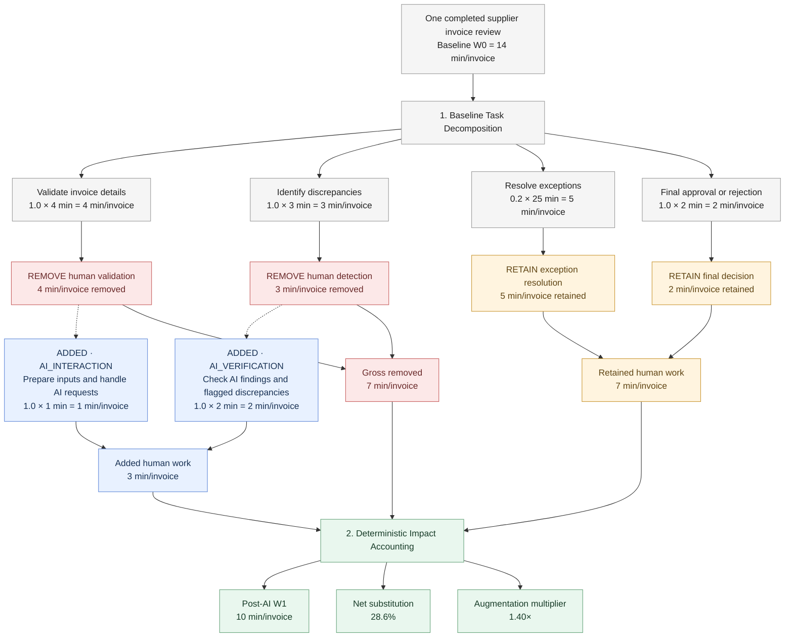

# Example: AI-Assisted Supplier Invoice Review

This example demonstrates how **Task Transmorph** decomposes an operational task, evaluates an AI-assisted transformation, and estimates its impact on **expected active human effort per completed parent output**.

It illustrates three capabilities:

1. **Task decomposition** — Identify baseline subtasks and estimate expected human effort per completed invoice.
2. **Transformation analysis** — Classify baseline human work as retained or removed, and estimate new AI interaction and verification work.
3. **Impact accounting** — Calculate post-AI effort, net substitution, and augmentation from a common output-anchored effort basis.

> [!NOTE]
> All durations, occurrence frequencies, classifications, and outcomes below are **illustrative assumptions**, not actual LLM-generated estimates or measured productivity improvements. They are not expected to match the executable example's output. Actual estimates depend on task context, provider, model, and assumptions.

## 1. Original Task and Output Unit

**Task:** Review and approve supplier invoices.

**Parent output:** **One completed invoice review**, ending in an approval or rejection decision. All effort quantities in this example are expected **active human minutes per completed invoice** (`min/invoice`), not elapsed processing time, invoice throughput, or staffing capacity.

**Operating context:** An accounts payable team receives supplier invoices, validates invoice details, identifies discrepancies, resolves exceptions when needed, and approves or rejects invoices.

**Transformation goal:** Introduce AI to perform preliminary invoice validation, identify discrepancies, and draft recommendations while retaining human exception handling and final approval.

**Illustrative operating assumptions:** Invoice and purchase-order records are available; every invoice receives validation, discrepancy screening, and a final decision; 20% require exception resolution. The stated durations represent active human work, excluding waiting or queue time. The illustrative transformation fully removes the specified manual validation and detection work, but adds human interaction and verification.

## 2. Transformation Workflow



The transformation **consumes the existing baseline decomposition** rather than creating a second baseline. `RETAIN` and `REMOVE` describe what happens to **human work**, not whether the business activity still occurs. For example, AI can perform invoice validation even when manual validation effort is removed.

Dotted arrows associate added AI-related human work with the removed activities it supports; they do **not** imply that every removed subtask must map one-to-one to an added activity.

## 3. Baseline Human Effort (W0)

For each subtask, calculate expected human effort **per completed invoice**:

```text
expected_effort_per_invoice
  = expected_occurrences_per_parent_output × active_effort_per_occurrence
```

| Baseline subtask | Expected occurrences/invoice | Active minutes/occurrence | Expected min/invoice | Share of W0 |
|---|---:|---:|---:|---:|
| Validate invoice details | 1.0 | 4 | 4 | 28.6% |
| Identify discrepancies | 1.0 | 3 | 3 | 21.4% |
| Resolve exceptions | 0.2 | 25 | 5 | 35.7% |
| Approve or reject invoice | 1.0 | 2 | 2 | 14.3% |
| **Total baseline (W0)** | | | **14** | **100%** |

For example, exception resolution occurs for an assumed 20% of invoices and takes 25 active minutes when it occurs. Its expected contribution is `0.2 × 25 = 5 min/invoice`. **Do not add 25 minutes to every invoice.**

The share column is **derived** from the absolute, output-anchored effort estimates; the percentages are not separate effort inputs. The displayed percentages are rounded.

## 4. AI Transformation Analysis

For this illustrative transformation, the original human subtasks are classified as follows:

| Baseline subtask | Classification | Baseline min/invoice | Post-AI retained min/invoice |
|---|---|---:|---:|
| Validate invoice details | `REMOVE` | 4 | 0 |
| Identify discrepancies | `REMOVE` | 3 | 0 |
| Resolve exceptions | `RETAIN` | 5 | 5 |
| Approve or reject invoice | `RETAIN` | 2 | 2 |
| **Total** | | **14** | **7** |

**Gross removed human work = 7 min/invoice.** This does not mean invoice validation or discrepancy detection stops happening; it means the corresponding *manual human effort* is removed in the illustrative AI-assisted process.

### Added Human Work

AI assistance also introduces human activities. These are estimated on the **same per-completed-invoice basis** as the baseline.

| Added activity | Category | Expected occurrences/invoice | Active minutes/occurrence | Expected min/invoice |
|---|---|---:|---:|---:|
| Prepare invoice inputs and handle AI requests | `AI_INTERACTION` | 1.0 | 1 | 1 |
| Review AI findings and flagged discrepancies | `AI_VERIFICATION` | 1.0 | 2 | 2 |
| **Total added human work** | | | | **3** |

These activities support the AI-assisted replacement of manual validation and detection. Their durations and frequencies are illustrative assumptions, not measured observations. More granular models could separate routine verification from additional checks triggered only by flagged invoices.

**Gross removed work and added human work must be accounted for separately.** Added work must not be counted again as retained baseline work.

## 5. Post-Transformation Human Effort (W1)

| Human work | Baseline min/invoice | Post-AI min/invoice |
|---|---:|---:|
| Manual invoice validation | 4 | 0 |
| Manual discrepancy detection | 3 | 0 |
| Exception resolution | 5 | 5 |
| Final approval or rejection | 2 | 2 |
| AI interaction | 0 | 1 |
| AI verification | 0 | 2 |
| **Total human effort** | **14** | **10** |

```text
Baseline human effort (W0)  = 14 min/invoice

Retained human work         =  7 min/invoice
Gross removed human work    =  7 min/invoice

Added AI interaction        =  1 min/invoice
Added AI verification       =  2 min/invoice
Total added human work      =  3 min/invoice

Post-AI human effort (W1)   = 7 + 3 = 10 min/invoice
```

All components use the same denominator: **one completed invoice review**. No FTE-hours, working-day assumptions, or machine-resource capacity are needed to calculate W0, W1, or their ratios.

## 6. Impact Accounting

Task Transmorph's deterministic accounting derives the impact ratios from compatible effort quantities.

### Gross Removed Work

```text
Gross removed work ratio
  = Gross removed human work / W0
  = (7 min/invoice) / (14 min/invoice)
  = 50.0%
```

### Net Substitution

```text
Net substitution ratio
  = 1 - (W1 / W0)
  = 1 - (10 / 14)
  ≈ 28.6%
```

### Augmentation Multiplier

```text
Augmentation multiplier
  = W0 / W1
  = 14 / 10
  = 1.40×
```

### Summary

| Metric | Illustrative result |
|---|---:|
| Parent output | One completed invoice review |
| Effort basis | Expected active human min/invoice |
| Baseline effort (W0) | 14 min/invoice |
| Retained human work | 7 min/invoice |
| Gross removed human work | 7 min/invoice |
| AI interaction work | 1 min/invoice |
| AI verification work | 2 min/invoice |
| Total added human work | 3 min/invoice |
| **Post-AI effort (W1)** | **10 min/invoice** |
| Gross removed work ratio | 50.0% |
| **Net substitution ratio** | **28.6%** |
| **Augmentation multiplier** | **1.40×** |

**Interpretation:** AI removes human activities representing 50% of baseline effort, but interaction and verification introduce an additional 3 min/invoice (21.4% of W0). The net expected reduction is **4 min/invoice**, or **28.6%**.

The augmentation multiplier is the reciprocal effort ratio for comparable completed outputs. It is **not** a measured throughput increase or an absolute output-capacity calculation. Staffing, available labor time, workflow bottlenecks, and realized throughput belong to downstream capacity/workflow models.

## 7. Run the Python Example

The repository includes an executable provider-assisted example:

[`supplier_invoice_transformation.py`](supplier_invoice_transformation.py)

From the repository root:

```bash
python examples/supplier_invoice_transformation.py
```

The example demonstrates the existing application workflow:

```python
baseline = decompose_task(
    request,
    provider="openai",
)

result = estimate_transformation(
    baseline,
    provider="openai",
    transformation_context={
        "goal": (
            "Use AI to validate invoice details and identify "
            "discrepancies while retaining human approval."
        )
    },
)
```

The snippet illustrates the core calls; `request` must first be constructed using `TaskDecompositionRequest` and `TaskReference`. Running the executable example requires a configured provider credential and makes live LLM calls.

> [!IMPORTANT]
> The **14 → 10 min/invoice** calculation above is an illustrative **output-anchored absolute-effort scenario**. It is **not** a claim that the current `estimate_transformation()` call returns absolute minutes/invoice. The existing provider-assisted path may return **normalized relative accounting** rather than absolute durations. Its live estimates are not expected to reproduce this scenario. An implementation path that accepts or estimates absolute effort inputs is needed before these quantities can be expected directly from that API.

## 8. Key Takeaways

- **One completed parent output is the denominator.** In this example, all effort quantities are expected active human minutes per completed invoice.
- **Occurrence frequency matters.** Expected effort per invoice equals expected occurrences per invoice multiplied by active effort per occurrence.
- **Baseline and transformation effort use the same basis.** Retained, removed, AI interaction, and AI verification work can be reconciled directly.
- **Gross removal is not net substitution.** Added human work offsets part of the removed effort.
- **Ratios are derived from effort**, not estimated independently: W0 = 14 min/invoice, W1 = 10 min/invoice, net substitution ≈ 28.6%, augmentation = 1.40×.
- **Effort per output is not output capacity.** The example does not estimate invoices/day, staffing requirements, or realized workflow throughput.
- **Estimates need provenance.** User-supplied or measured effort should be distinguished from LLM-estimated assumptions; this worked example uses illustrative assumptions.

For the general architecture, see the [Task Transmorph README](../README.md).

For mathematical definitions and accounting constraints, see the [Accounting Model](../docs/reference/ACCOUNTING_MODEL.md).
